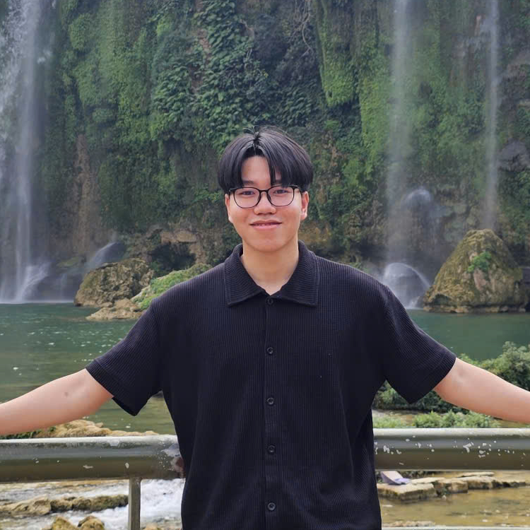

# Thai Hung Nguyen

**AI Engineer & Computer Vision Researcher**  
Vice President @ FU-DEVER Coding Club • FPT University Da Nang  
Da Nang, Vietnam

[English](README.md) • [Tiếng Việt](README_VI.md)

---

[Curriculum Vitae (PDF)](assets/Thai_Hung_Nguyen_CV.pdf) &nbsp;|&nbsp; [LinkedIn](https://www.linkedin.com/in/thai-hung-nguyen-000b24356/) &nbsp;|&nbsp; [GitHub](https://github.com/huanight19RaH) &nbsp;|&nbsp; [LeetCode](https://leetcode.com/u/HungNguyen192/) &nbsp;|&nbsp; [Email](mailto:hungnguyen.190206@gmail.com)

---

## Overview

<table>
  <tr>
    <td width="78%" valign="top">
      
I am a 3rd-year <b>Artificial Intelligence (AI)</b> undergraduate student at <b>FPT University Da Nang</b> and currently serve as the <b>Vice President of FU-DEVER Coding Club</b>. My trajectory integrates empirical <b>Computer Vision</b>, <b>Image Restoration</b>, and scalable <b>Machine Learning Systems</b> with academic leadership.

      <ul>
        <li><b>Research:</b> Focused on Physics-Informed Deep Learning, Underwater Image Restoration, and Low-Light Image Enhancement (LLIE). Co-authored 1 conference paper published in <b>Springer MIWAI 2026</b> and authored 1 accepted paper on underwater restoration.</li>
        <li><b>Leadership &amp; Community:</b> Leading academic workshops, hackathons, and mentorship programs at FU-DEVER; former Media Lead for the Sunshine Team charity initiative.</li>
        <li><b>Certifications:</b> IELTS 6.0 (2024).</li>
      </ul>
    </td>
    <td width="22%" align="center" valign="middle">
      
       
      <b>Thai Hung Nguyen</b>
    </td>
  </tr>
</table>

---

## Publications & Academic Research

### 1. HybridLLIENet: Multi-Space Luminance Prior Fusion for Low-Light Image Enhancement
- **Venue:** International Conference on Multi-disciplinary Trends in Artificial Intelligence (MIWAI 2026), **Springer**
- **Role:** Co-Author
- **Methodology:** Explored low-light image restoration using multi-space luminance prior fusion (LAB-L, HSV-V, YCbCr-Y) boosted with CLAHE and gamma correction on a U-Net backbone. Contributed to literature review, experimental discussion, and benchmarking across LOL datasets.
- **Empirical Results:** Achieved **21.23 dB PSNR**, **0.858 SSIM**, and **0.127 LPIPS** on LOLv2-Real with a lightweight footprint of **8.04M parameters and 79.26 GFLOPs**.
- **Links:** [Paper (Springer Link)](https://link.springer.com/chapter/10.1007/978-981-92-6513-8_10) &nbsp;|&nbsp; [Repository](https://github.com/huanight19RaH)

### 2. Assessing Physics-Informed Priors in Underwater Image Restoration
- **Status:** Accepted Conference Paper
- **Role:** Author
- **Methodology:** Formulated transmission map *t(x)* and backscatter map *B(x)* as auxiliary physical channels in customized U-Net architectures, evaluating RGB, RGB + *t(x)*, RGB + *B(x)*, and RGB + *t(x)* + *B(x)* configurations.
- **Empirical Results:** Attained **21.012 dB PSNR / 0.884 SSIM** on UIEB T90 and **26.644 dB PSNR / 0.873 SSIM** on EUVP-Test with the 5-channel model.
- **Links:** [Repository](https://github.com/heniath/underwater-image-enhancement)

---

## Featured Engineering Projects

### Traffic Flow Detection — Video-Based Analytics Platform
- **Scope:** End-to-end traffic analytics platform supporting multi-class vehicle detection, tracking, lane assignment, and directional tripwire counting. Architected video ingestion and frontend workflows: ROI lane configuration, real-time analytics streaming, and interactive dashboards.
- **Tech Stack:** Python, FastAPI, YOLO, ByteTrack, OpenCV, React
- **Benchmark:** Achieved **Event F1: 0.942, WAPE: 5.04%** on UA-DETRAC test sets; batch throughput of **75.8 FPS** (3.03x real-time) and livestreaming at **14.9 FPS** with zero frame drop.
- **Links:** [Repository](https://github.com/monsierpotato/Traffic-Flow)

### ScholarSummar — RAG-Based Research Assistant
- **Scope:** Intelligent scientific assistant supporting academic PDF ingestion, hybrid lexical-dense search, and conversational document Q&A. Engineered RAG pipeline stages (chunking, embedding, semantic retrieval), frontend interfaces, backend integration tests, and Docker deployment.
- **Tech Stack:** Next.js, FastAPI, PostgreSQL (pgvector), Qdrant, Redis, MinIO, Docker
- **Links:** [Repository](https://github.com/quangnhat1504/SchoolSummar)

---

## Technical Skills

| Area | Technologies |
| :--- | :--- |
| **Deep Learning & Computer Vision** | PyTorch, TensorFlow, OpenCV, scikit-learn, U-Net, YOLO, ByteTrack, Physics-Informed DL |
| **Languages & Systems** | Python, C/C++, SQL, FastAPI, Next.js, NumPy, pandas |
| **Infrastructure & Tools** | Docker, Linux (Ubuntu), Git, GitHub, PostgreSQL, Qdrant, Redis, Jira |

---

## Honors & Awards

- **Consolation Prize** — Research Festival 2026 / Research Connect, FPT University Da Nang (May 2026)  
  *Honored for applied computer vision and image restoration research.*
- **Second Prize** — Code Mosaic 2025 Programming Hackathon, FPT University Da Nang (October 2025)  
  *Annual competitive programming hackathon focusing on algorithms and data structures.*
- **Consolation Prize** — Da Nang City Excellent Student Contest in Mathematics (January 2024)  
  *Awarded by the Da Nang Department of Education and Training.*

---

## Problem Solving & Activity

  

---

## Contact & Links

- **Email:** [hungnguyen.190206@gmail.com](mailto:hungnguyen.190206@gmail.com)
- **LinkedIn:** [thai-hung-nguyen-000b24356](https://www.linkedin.com/in/thai-hung-nguyen-000b24356/)
- **GitHub:** [huanight19RaH](https://github.com/huanight19RaH)
- **LeetCode:** [HungNguyen192](https://leetcode.com/u/HungNguyen192/)
- **Facebook:** [thaihung.0219](https://www.facebook.com/thaihung.0219)
